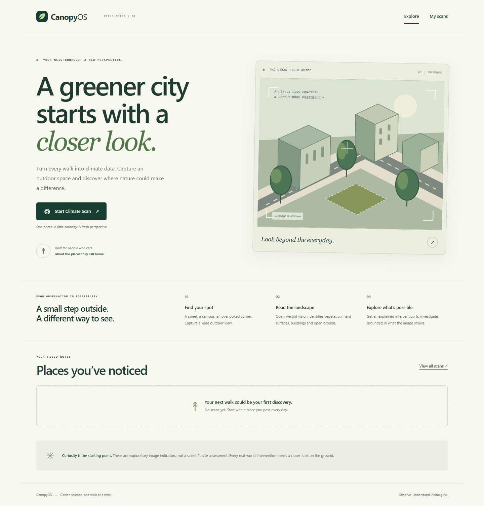
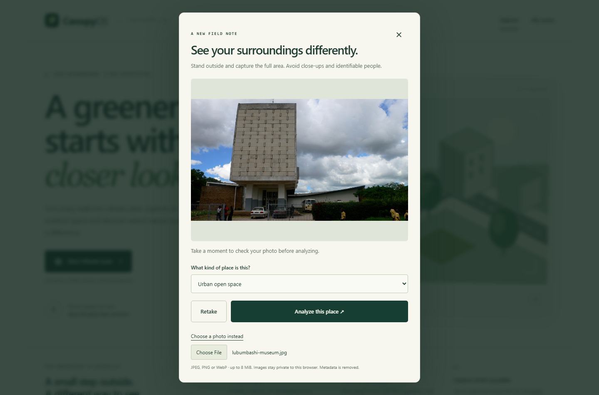
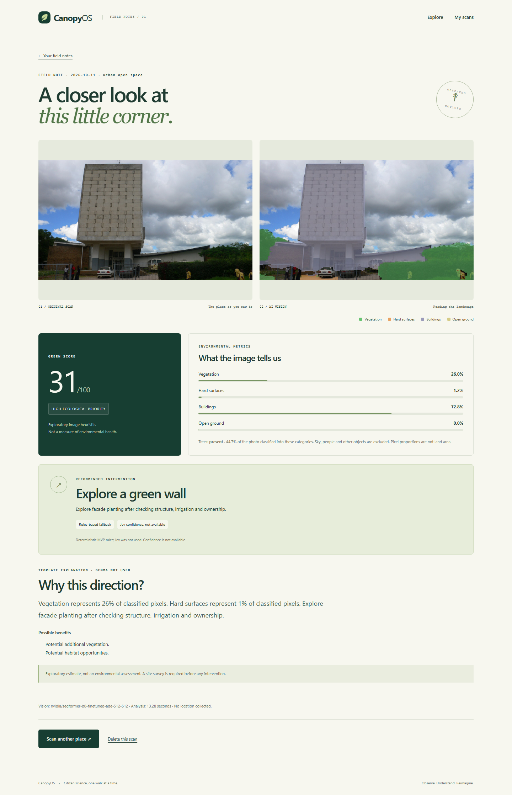
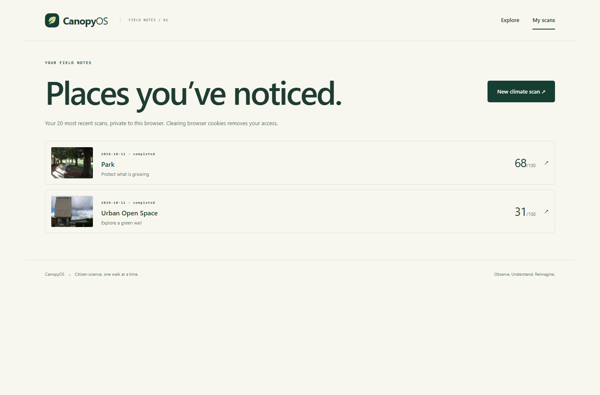
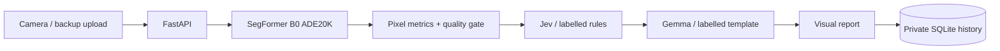

# CanopyOS

**Turn every walk into climate data.**

A mobile-first citizen-science prototype: photograph an outdoor place, inspect a
real segmentation overlay, and explore a grounded greening recommendation.
English UI, FastAPI, HTMX, Tailwind, SQLite and open-weight SegFormer.



Built during Hacktoberfest Hack Day week (October 2026). See the
[submission summary](docs/submission.md) for a concise project description and
demo checklist. The illustration above is not an analyzed photograph.

### See the workflow

The screenshots below show a real application run using an openly licensed
photograph of the National Museum of Lubumbashi.

**1. Capture an outdoor scene**



**2. Inspect the segmentation and field note**



**3. Revisit private scans**



See the [full desktop and mobile gallery](docs/demo-gallery.md) for a second
scene, phone layouts, measured outputs and photo credits.

## Run locally (Windows PowerShell)

```powershell
python -m venv .venv
.\.venv\Scripts\python.exe -m pip install --upgrade pip
.\.venv\Scripts\python.exe -m pip install -r requirements-dev.txt -r requirements-vision.txt
npm ci
npm run build
Copy-Item .env.example .env
.\.venv\Scripts\python.exe -m uvicorn app.main:app --host 127.0.0.1 --port 8000
```

Open http://127.0.0.1:8000. Python 3.12+ and Node 20+ are required. On macOS/Linux,
use `.venv/bin/python` and `cp .env.example .env`. The first scan downloads the pinned
SegFormer weights; internet is required for that first download. Subsequent vision
inference runs locally on CPU. An 8 MiB maximum applies to each photo.

On Windows, `./scripts/start.ps1` starts the local server in the background without
opening a console window. Logs are saved under `artifacts/`.

The setup does **not** activate live Jev or Gemma. Without configuration, the report
explicitly says **Rules-based fallback** and **Template explanation — Gemma not used**.
There is no fake vision mode in the application. Vision failure produces an error.

## Connect the models

### Jev

Obtain your own key from TypeSafe and set `JEV_API_KEY` in `.env`. The adapter uses
`https://api.typesafe.ai/v1/systemone` and the documented Choice request/response.
It sends numeric metrics, area type and unknown feasibility flags, never a photo.
Set `JEV_MODEL` to an available pinned model for a reproducible submission.
Missing key, timeout, invalid distribution or invalid action triggers a labelled
rules fallback with **null confidence**, not a made-up probability. Low Jev
confidence routes to HUMAN_REVIEW. Jev is a hosted service, not an open-weight model.

### Gemma

Install an Ollama runtime separately, then:

```text
ollama pull gemma3:1b
```

Set `GEMMA_ENDPOINT=http://127.0.0.1:11434` in `.env` and restart CanopyOS. A hosted
Ollama-compatible service can use HTTPS and `GEMMA_API_KEY`. Gemma selects an English
explanation from evidence-backed sentences under a JSON schema. This deliberate
MVP constraint prevents new numeric or causal claims; it is not free-form prose.
The response is validated again server-side. Invalid output or timeout falls back
to the same factual sentence bank and is labelled. Follow Gemma's model terms.

Only configure trusted endpoints. Never paste secrets into commits or screenshots.

## Architecture



See [architecture](docs/architecture.md) for category mappings, denominator,
quality thresholds, contracts and security boundaries. API documentation is
available at `/docs` in local development. No accounts or geolocation in this MVP.

* Capture, preview and retake, with gallery upload as backup.
* Real local vision; vegetation, hard-surface, building and open-ground masks.
* Deterministic Green Score and priority; tree presence rather than invented counts.
* Finite intervention selection and an explanation with a fixed disclaimer.
* Server-reported progress, recoverable failures and a 20-scan private history.
* Deletion removes both images and the database record.
* Open-ground candidate visualization for tree proposals, explicitly conceptual.

## Test and build

```powershell
.\.venv\Scripts\python.exe -m pytest -q
.\.venv\Scripts\python.exe -m ruff check app tests scripts
npm run build
npx playwright install chromium
npm run test:browser
.\.venv\Scripts\python.exe -m pip_audit --progress-spinner off
npm audit
```

Browser tests launch a separate isolated server on port 8001 with a clearly named
test-only vision double. They test UI wiring, not ML accuracy. Unit tests never
call paid providers. Real model checks are separate:

```powershell
.\.venv\Scripts\python.exe scripts/validate_scenes.py --images path/to/photos
```

See [validation record](docs/validation.md). Model and provider quality need field
validation; passing software tests alone does not validate environmental advice.

## Privacy and limitations

Photos are re-encoded without EXIF/GPS metadata. UUID file names, signed HTTP-only
SameSite cookies and ownership checks keep each browser's history separate. Clearing
cookies loses access; accounts and recovery are outside scope. The operator controls
retention on disk. Avoid photographing identifiable people. No face recognition.

One application process, one inference job at a time. Uploads and inference are
rate-limited. Requests above the capacity return an actionable retry response.
Do not scale to multiple workers without replacing the local job coordination.

The camera needs HTTPS on a real phone; localhost is allowed on the same computer.
Opening the desktop's HTTP LAN address on a phone does not enable camera access.
Gallery upload is the backup. There is no PWA offline mode in this version.

The score uses `round(100 * (.60 * vegetation + .25 * open_ground + .15 * tree_presence))`.
Fractions describe classified **image pixels**, not true land area. Sky, people and
vehicles are excluded and classified coverage is shown. Soil does not prove that
planting is permitted. Tree presence does not measure shade. No temperature, CO2,
biodiversity or power production estimate is made. Scene-quality gates are
heuristics and cannot guarantee all indoor or misleading images are rejected.

## Deployment and submission

See [deployment](docs/deployment.md) for Render/Docker, persistence and HTTPS.
The repository is deployment-prepared; creating paid hosting, setting secrets,
testing a physical phone outdoors and publishing the competition submission still
require the operator's accounts and field checks.

See [demo script](docs/demo.md) for a 60–90 second walkthrough. Screenshots and
test traces are generated under ignored `artifacts/`; no fabricated demo recording
is included. Add your own outdoor recording before submitting.

## Why open source matters

Open application code and accessible model weights make the segmentation pipeline,
class mapping, decision rules and score inspectable and reproducible. That helps
citizens question an output instead of accepting an opaque environmental claim.
SegFormer weights have their own license; Gemma has its own terms; Jev is external.

## Roadmap

After field validation: multi-scan comparison, opt-in approximate location and maps.
Later: expert-calibrated scoring, collaborative projects and exports. P2 features
such as accounts, leaderboards, audio and digital twins are intentionally excluded.

## License and sources

Application code: MIT (see LICENSE). Vendored HTMX: 0BSD
(`app/static/htmx-LICENSE.txt`). Third-party model weights and test images are not
relicensed by this repository. Demonstration photographs within the gallery retain
their own licenses. See [sources](docs/sources.md) and [photo credits](docs/demo-gallery.md#photo-credits).
