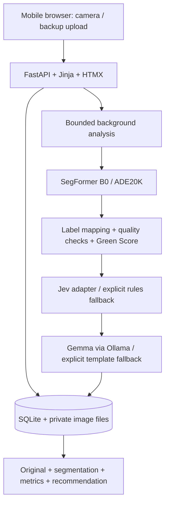

# CanopyOS MVP architecture

## Approved product baseline

The supplied CanopyOS brief is the product specification. Build a mobile-first
citizen-science web app: capture an outdoor image, segment it, calculate exploratory
metrics, choose a bounded intervention, and explain it. All product text, code,
tests and technical documentation are English. No scientific certification claims.

## One deployable application

No microservices, task broker, account system or native app. One worker process,
one analysis at a time, bounded upload sizes and scan retention. External adapters
receive only metrics and the selected action, never raw images or location.

## Capabilities and dependencies

| ID | Capability | Depends on | Acceptance |
|---|---|---|---|
| C1 | Secure capture, storage, deletion | None | Valid image in; private scan out; deletion removes assets |
| C2 | Real segmentation and quality gate | C1 | Label mask and overlay; unusable scenes rejected |
| C3 | Metrics and exploratory score | C2 | Deterministic, tested mapping and score |
| C4 | Finite intervention decision | C3 | Allowed action, provenance, confidence or honest null |
| C5 | Grounded English explanation | C4 | Constrained content, disclaimer, visible fallback |
| C6 | Report and recent history | C1–C5 | Mobile flow, genuine progress, retry and deletion |

Build in that order. The first slice proves C3 independently using known masks;
the second adds C1; then C2/C4/C5 connect to C6. P1 history is included. A conceptual
candidate-ground overlay is optional only after the P0 flow passes. P2 is excluded.

## Data and API contract

SQLite stores each scan's UUID, anonymous browser owner, UTC creation time, area
type, status, stage, error and validated report JSON. Report JSON contains the
metrics and recommendation: one record avoids unnecessary joins for 20 scans.
Assets live under DATA_DIR, outside the public static directory; every access checks
ownership. A signed HTTP-only SameSite cookie identifies a browser, not a person.
Clearing cookies loses access. Keep the newest 20 scans per browser; delete older
assets. No geolocation is collected in P0.

* `GET /api/v1/health`: actual loaded/unconfigured/degraded service states.
* `POST /api/v1/scans`: multipart image, area_type; 201 with uploaded scan.
* `POST /api/v1/scans/{id}/analyze`: 202 starts work, 409 if server busy.
* `GET /api/v1/scans/{id}`: stage, status and report; used for polling.
* `GET /api/v1/scans?limit=20&offset=0`: owner's history only.
* `DELETE /api/v1/scans/{id}`: deletes owner's record and image assets.

The asynchronous 202/polling contract intentionally refines the example synchronous
response from the brief so progress reflects real pipeline stages. Startup marks
interrupted jobs failed. Completed scans are idempotent on analyze. Running scans
cannot be deleted. No public image URL or public scan list.

## Measurement semantics

ADE20K categories: vegetation = tree/grass/plant/palm; hard surface = road/sidewalk;
buildings = building/wall/house/skyscraper; open ground = earth/land/dirt track/sand.
Other classes (including sky, people and vehicles) are excluded from the denominator.
Expose classified_coverage as the fraction of the whole photo used. These are image
pixel proportions, not measured land area. Sand and soil do not prove plantability.
Trees are present if tree/palm pixels exceed 1% of classified pixels. Do not invent
an instance count or infer actual shade from a semantic mask.

`score = round(100 * clamp(.60 * vegetation + .25 * open_ground + .15 * tree_presence, 0, 1))`.
Priority: 0–34 HIGH, 35–64 MEDIUM, 65–100 LOW. The sample score 31 in the brief is
illustrative and does not equal this formula; the implemented formula takes precedence.
This heuristic is not calibrated; it does not estimate heat, carbon or biodiversity.

Reject images that are too small, dark, flat/blurred, predominantly indoor, low in
recognized surface coverage or low in segmentation confidence. Quality thresholds
are demo heuristics requiring field validation. No recommendation for rejected scans.

## Integration boundaries

SegFormer uses local inference, cached open weights and no color-based imitation.
Model unavailable => explicit failure, never a fabricated segmentation.
Jev uses the verified TypeSafe Choice contract when configured. Missing key, timeout,
invalid output => deterministic rules labelled rules_fallback, with confidence null.
Gemma uses an operator-configured Ollama endpoint and JSON schema. An evidence
selection contract limits output to approved factual sentences and qualitative
benefits; invalid selections => labelled template_fallback. No invented measurements.

## Security and operations

8 MiB image limit plus bounded multipart body; JPEG/PNG/WebP verified by Pillow;
pixel-count limit; EXIF orientation then clean RGB re-encode. No original metadata.
Parameterized SQLite; Jinja escaping; same-origin mutations; private no-store assets;
session ownership; per-browser and global upload/analysis caps; one inference slot.
DATA_DIR contains generated images and a persistent signing key; never commit it.
Render requires HTTPS and a persistent disk for SQLite and model cache. Localhost
camera works for desktop; physical phones need HTTPS. No automatic paid deployment.

## Verification and commands

Setup: `python -m venv .venv`, activate it, `pip install -r requirements-dev.txt`,
`pip install -r requirements-vision.txt`, `npm ci`, `npm run build`.
Run: `python -m uvicorn app.main:app --host 127.0.0.1 --port 8000` (one worker).
Test: `python -m pytest -q`; lint: `python -m ruff check .`; UI: `npm run test:browser`.
Tests cover known masks, score boundaries, provider failures, upload rejection,
ownership, deletion, duplicate analysis, and a browser upload-to-report flow.
Real-model smoke tests and field photo validation are separate from deterministic
test doubles; record actual evidence instead of claiming target latency achieved.

Python uses typed small functions, Pydantic contracts, snake_case, and explicit
errors: `def green_score(vegetation: float, ground: float, trees: bool) -> int:`.
Always validate external input and test critical behavior. Never commit credentials,
fake provider provenance or silently replace real vision. Confirm new paid services
or changed product scope with the user; routine work within this brief is authorized.

## Primary references

- https://fastapi.tiangolo.com/tutorial/request-files/
- https://huggingface.co/nvidia/segformer-b0-finetuned-ade-512-512
- https://docs.typesafe.ai/introduction
- https://docs.ollama.com/api/chat
- https://htmx.org/docs/
- https://tailwindcss.com/docs/installation/tailwind-cli
- https://render.com/docs/disks
