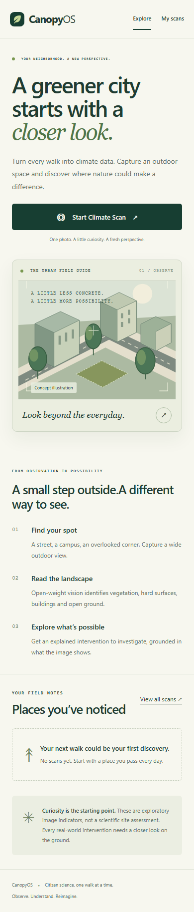
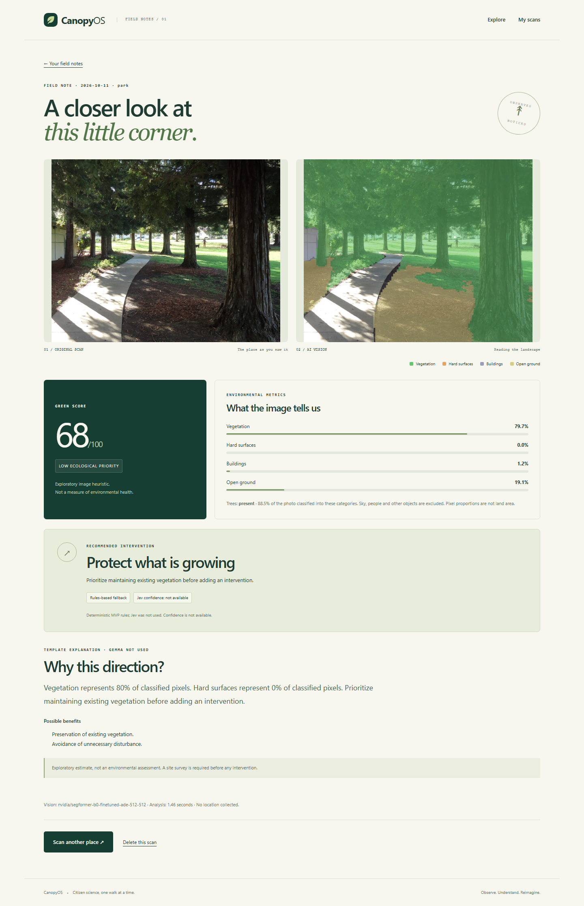

# CanopyOS product gallery

These screenshots were captured from the running application on 11 October 2026.
The segmentation overlays, scores and recommendations are the outputs of the
pinned SegFormer model and the app's documented rules. Jev and Gemma were not
configured for this demonstration; the report identifies those fallbacks.

To reproduce the flow locally, upload the included
[Lubumbashi museum photo](demo-photos/lubumbashi-museum.jpg) or
[Cupertino park photo](demo-photos/cupertino-park.jpg). The exact pixel ratios may
vary with model or image-processing updates.

## Observe

The home illustration is original concept art. The capture screen below uses a
photograph of the National Museum of Lubumbashi.

[View the mobile capture screen](images/capture-mobile.png).

## Analyze

[View the museum report on a phone](images/lubumbashi-museum-report-mobile.png).

For this image, 44.7% of pixels were assigned to the four reported categories.
Within those classified pixels, the app found 26.0% vegetation and 72.8%
buildings. Its exploratory score was 31/100; the rules fallback proposed
investigating a green wall after a site survey. These figures describe the photo,
not the land area or current conditions at the site.

## Compare and revisit

[View the park report on a phone](images/cupertino-park-report-mobile.png).

The park photo produced a score of 68/100 and a preservation recommendation.
The history page keeps both private scans in the same browser session.

[View the history on a phone](images/history-mobile.png).

## Photo credits

- **National Museum of Lubumbashi:** photograph by
  [Mike Rosenberg on Wikimedia Commons](https://commons.wikimedia.org/wiki/File:Lubumbashi_Museum.jpg),
  [CC BY 2.0](https://creativecommons.org/licenses/by/2.0/). The photograph was
  taken in 2007. It was resized and re-encoded for this software demonstration;
  the application added the segmentation overlay. It is not a survey of the
  museum's present condition.
- **Cupertino public park:** photograph by
  [Tomwsulcer on Wikimedia Commons](https://commons.wikimedia.org/wiki/File:Trees_along_walkway_in_public_park_in_Cupertino,_California.JPG),
  [CC0 1.0](https://creativecommons.org/publicdomain/zero/1.0/), taken in 2015.
  It was resized and re-encoded for the application screenshots.

Photo licenses apply to the photographs within these screenshots. The app's
source code remains under its own MIT license.
